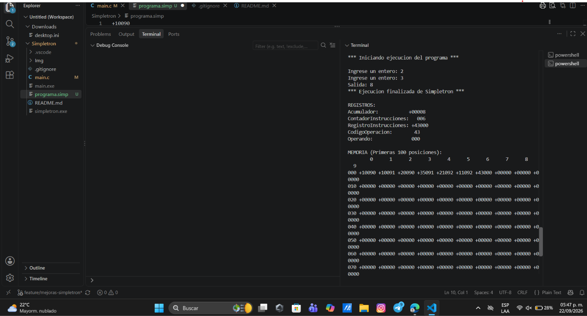

# Simpletron: simulador, expresiones y compilador Simple → SML (en C)

Proyecto final de programación. Contiene:

1. **Programas en SML** (Simpletron Machine Language) con secuencia, selección y repetición.
2. **Simulador Simpletron 1000**: ciclo de instrucción, registros especiales, *memory dump* y errores fatales.
3. **Mejoras al simulador**: memoria de 1000 palabras, carga desde `programa.simp` o cualquier archivo, residuo, potencia, salto de línea, cadenas y punto flotante.
4. **Evaluación de expresiones**: balance de `( ) [ ] { }`, profundidad de anidamiento, conversión de infijo a postfijo y evaluación del postfijo.
5. **Lenguaje Simple**: `rem`, `input`, `let`, `print`, `goto`, `if/goto` y `end`.
6. **Compilador Simple → SML** de dos pasadas, con tabla de símbolos y resolución de referencias hacia adelante.

**Integrante:** Ricardo Jesús Tepale Ahuatl, UPAEP

---

## 📁 Estructura del repositorio

```
Simpletron/
├── README.md
├── Makefile                 compilación con make
├── compilar.bat             compilación en Windows (doble clic o desde CMD)
├── docs/
│   ├── requerimientos.md    rúbrica → dónde se cumple cada criterio
│   └── diseno.md            diseño, formatos y bitácora de decisiones
├── src/
│   ├── simpletron/
│   │   ├── opcodes.h        conjunto de instrucciones SML (compartido)
│   │   └── simpletron.c     simulador
│   ├── expresiones/
│   │   ├── pila.h           pila de enteros
│   │   ├── expresiones.h/.c agrupación, profundidad, infijo→postfijo y evaluación
│   │   └── evaluador.c      programa para probar el módulo
│   └── compilador/
│       └── compilador.c     compilador Simple → SML (dos pasadas)
├── programas/
│   ├── sml/                 programas SML escritos a mano, programa.simp y errores/
│   └── simple/              programas Simple con su .sml generado y errores/
├── pruebas/
│   ├── ejecutar_pruebas.sh  51 pruebas automáticas
│   ├── entradas/            datos que se teclean en cada prueba
│   └── salidas/             salida esperada de cada prueba
└── evidencias/
    ├── git-branch/          capturas del laboratorio de ramas
    └── ejecuciones/         transcripciones y capturas de ejecución
```

## 🛠️ Compilación

Se necesita `gcc` (MinGW o MSYS2 en Windows, GCC o Clang en Linux y macOS).

**Windows:** ejecuta `compilar.bat`, o escribe en la terminal:

```bash
mkdir bin
gcc -std=c99 -Wall -o bin/simpletron src/simpletron/simpletron.c -lm
gcc -std=c99 -Wall -o bin/evaluador  src/expresiones/evaluador.c src/expresiones/expresiones.c
gcc -std=c99 -Wall -o bin/compilador src/compilador/compilador.c src/expresiones/expresiones.c
```

**Con make** (Linux, macOS, Git Bash o MSYS2):

```bash
make            # compila los tres programas en bin/
make pruebas    # compila y ejecuta las pruebas
make clean
```

El proyecto compila sin advertencias con `-Wall -Wextra -pedantic`.

## 🚀 Ejecución

En Windows, usa `bin\simpletron.exe` en lugar de `./bin/simpletron`.

### Simulador

```bash
./bin/simpletron programas/sml/suma_dos.sml     # carga el archivo indicado
cd programas/sml && ../../bin/simpletron        # sin argumentos carga programa.simp
./bin/simpletron                                # sin programa.simp: carga interactiva
```

| Opción       | Efecto                                                              |
|--------------|---------------------------------------------------------------------|
| `--traza`    | muestra cada instrucción: dirección, palabra, mnemónico y acumulador |
| `--sin-dump` | no imprime el vaciado de memoria al terminar con HALT (si hay error fatal, sí lo imprime) |
| `--eco`      | repite cada dato leído (útil al redirigir la entrada desde un archivo) |

Códigos de salida: `0` = terminó con HALT, `1` = error al cargar, `2` = error fatal.

### Evaluador de expresiones

```bash
./bin/evaluador                                   # una expresión por línea
./bin/evaluador pruebas/entradas/expresiones.txt
./bin/evaluador --profundidad 2 archivo.txt       # limita el anidamiento
```

Se pueden dar valores a las variables después de `;`, por ejemplo: `(a + b) * c ; a=2 b=3 c=10`.

### Compilador

```bash
./bin/compilador programas/simple/factorial.simple            # genera factorial.sml
./bin/compilador programas/simple/factorial.simple --detalle  # muestra las dos pasadas
./bin/compilador programas/simple/factorial.simple --tabla    # muestra la tabla de símbolos
./bin/simpletron programas/simple/factorial.sml               # ejecuta el resultado
```

Sin argumentos, el compilador pregunta el nombre del archivo.

## 💻 Ejemplos de entrada y salida

**Programa SML** `programas/sml/suma_dos.sml`, con entrada `15` y `27`:

```
*** Programa cargado desde programas/sml/suma_dos.sml ***
*** Inicia la ejecucion del programa ***
? 15
? 27
42
*** Ejecucion de Simpletron terminada (HALT) ***

REGISTROS:
accumulator          +00042
instructionCounter      006
instructionRegister  +43000
operationCode            43
operand                 000

MEMORIA (se omiten las filas que estan completamente en cero):
             0      1      2      3      4      5      6      7      8      9
000   +10900 +10901 +20900 +30901 +21902 +11902 +43000 +00000 +00000 +00000
  ... (89 filas en cero)
900   +00015 +00027 +00042 +00000 +00000 +00000 +00000 +00000 +00000 +00000
  ... (9 filas en cero)
```

**Error fatal** (`programas/sml/errores/division_cero.sml`, entrada `8` y `0`):

```
*** ERROR FATAL: intento de division entre cero (instruccion en la direccion 003) ***
*** La ejecucion de Simpletron termino en forma anormal ***
```

**Evaluador:**

```
Expresion  : {a + [b * (c - 1)]} / 2
Agrupacion : correcta (profundidad maxima 3)
Postfijo   : a b c 1 - * + 2 /
Variables  : a=4 b=3 c=5
Resultado  : 8
```

**Compilador.** De `programas/simple/suma.simple` genera `suma.sml`:

```
10 rem   suma dos enteros        +10999   ; 000  READ         999   | 30 input a
30 input a                 →     +10998   ; 001  READ         998   | 40 input b
40 input b                       +20999   ; 002  LOAD         999   | 60 let c = a + b
60 let c = a + b                 +30998   ; 003  ADD          998
80 print c                       +21997   ; 004  STORE        997
99 end                           +11997   ; 005  WRITE        997   | 80 print c
                                 +43000   ; 006  HALT         000   | 99 end
```

Hay transcripciones completas en [`evidencias/ejecuciones/`](evidencias/ejecuciones/). La captura original de la Fase 2 sigue en `evidencias/ejecuciones/img/`:



## 📋 Instrucciones SML (Simpletron 1000)

Cada palabra es un entero decimal con signo entre `-99999` y `+99999`. Una instrucción tiene la forma `+CCOOO`: `CC` es el código de operación y `OOO` es una dirección de memoria (000–999).

| Opcode | Instrucción   | Descripción                                               | Tipo      |
|:------:|---------------|-----------------------------------------------------------|-----------|
| 10 | `READ`         | lee un entero del teclado a memoria                       | base      |
| 11 | `WRITE`        | imprime un entero de memoria                              | base      |
| 12 | `NEWLINE`      | imprime un salto de línea                                 | extensión |
| 13 | `READ_STRING`  | lee una cadena: `[d]` = longitud, `[d+1..]` = código ASCII | extensión |
| 14 | `WRITE_STRING` | imprime la cadena guardada desde `d`                      | extensión |
| 20 | `LOAD`         | acumulador ← memoria                                      | base      |
| 21 | `STORE`        | memoria ← acumulador                                      | base      |
| 30 | `ADD`          | suma                                                      | base      |
| 31 | `SUBTRACT`     | resta                                                     | base      |
| 32 | `DIVIDE`       | división entera                                           | base      |
| 33 | `MULTIPLY`     | multiplicación                                            | base      |
| 34 | `MODULO`       | residuo                                                   | extensión |
| 35 | `EXPONENT`     | potencia                                                  | extensión |
| 40 | `BRANCH`       | salto incondicional                                       | base      |
| 41 | `BRANCHNEG`    | salta si el acumulador es negativo                        | base      |
| 42 | `BRANCHZERO`   | salta si el acumulador es cero                            | base      |
| 43 | `HALT`         | termina                                                   | base      |
| 50 | `READ_FLOAT`   | lee un real y lo guarda ×100 (punto fijo, 2 decimales)    | extensión |
| 51 | `WRITE_FLOAT`  | imprime un real con 2 decimales                           | extensión |
| 52 | `ADD_FLOAT`    | suma de reales                                            | extensión |
| 53 | `SUB_FLOAT`    | resta de reales                                           | extensión |

**Formato de los archivos `.sml` y `.simp`:** una palabra por línea. `;` o `#` inician un comentario. `@NNN` cambia la dirección de carga, lo que sirve para separar la zona de datos. `-999999` termina la carga y es opcional.

## 📖 Lenguaje Simple

| Comando       | Ejemplo                            | Notas                                          |
|---------------|------------------------------------|------------------------------------------------|
| `rem`         | `10 rem calcula el promedio`       | comentario; es el único lugar donde se permiten mayúsculas |
| `input`       | `20 input a` · `20 input a, b`     | lee uno o más enteros                          |
| `let`         | `30 let c = (a + b) ^ 2 % 7`       | operadores `+ - * / % ^`; agrupación `( ) [ ] { }` |
| `print`       | `40 print c` · `40 print a, b * 2` | imprime variables, constantes o expresiones    |
| `goto`        | `50 goto 20`                       | salto incondicional                            |
| `if ... goto` | `60 if a >= b goto 90`             | `== != < <= > >=`                              |
| `end`         | `99 end`                           | termina el programa                            |

Reglas: cada línea empieza con un número de línea mayor que el anterior, las variables son de una letra minúscula y las constantes son enteras.

## ✅ Pruebas

```bash
make pruebas          # o:  bash pruebas/ejecutar_pruebas.sh   (en Windows, desde Git Bash)
```

Son **51 casos**: programas SML, carga interactiva, traza, cada error fatal, cada extensión, el evaluador, la compilación y la ejecución de cada programa Simple, y los errores del compilador. Cada caso compara la salida obtenida con la de `pruebas/salidas/`.

## 🌿 Ramas de Git

| Rama | Contenido |
|------|-----------|
| `feature/mejoras-simpletron` | Fase 2: memoria de 1000, opcodes nuevos y `programa.simp` |
| `feature/pila-anidamiento`, `feature/conversion-postfijo`, `feature/evaluacion-postfijo` | primeras versiones de las expresiones |
| `feature/compilador-primera-pasada` | primera y segunda pasada del compilador |
| `refactor/estructura-carpetas` | reorganización a la estructura sugerida |
| `feature/simulador-errores-fatales` | errores fatales, validación de carga y programas SML |
| `feature/expresiones-integradas` | módulo de expresiones unificado |
| `feature/compilador-completo` | `let`, `if/goto`, constantes y errores de sintaxis |
| `docs/pruebas-y-documentacion` | pruebas, README, docs y evidencias |

Todas se fusionaron a `main` con `--no-ff`. Las capturas del laboratorio de ramas están en [`evidencias/git-branch/`](evidencias/git-branch/).

## ⚠️ Limitaciones conocidas

* `if` compara restando (`a - b`), así que valores con una diferencia mayor que 99999 desbordan el acumulador. El simulador lo detecta como error fatal.
* El punto flotante usa punto fijo con 2 decimales y rango de ±999.99.

## Créditos y atribución

* Simpletron, SML y Simple se basan en Deitel & Deitel, *Cómo programar en C/C++* (Simpletron, sus modificaciones y el compilador).
